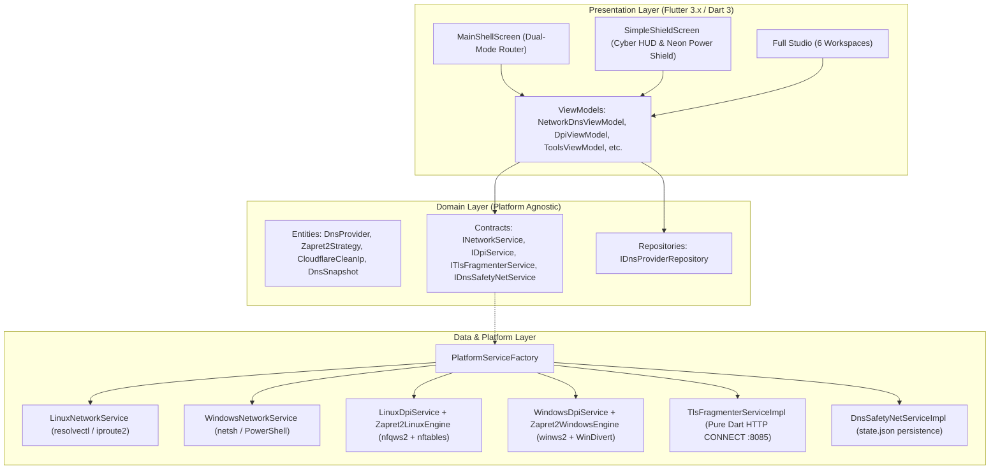
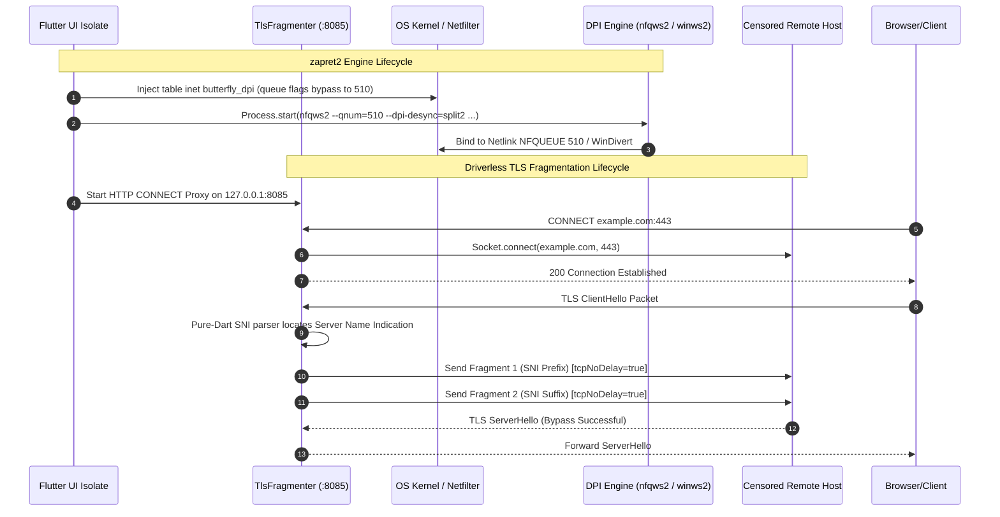

# Butterfly Architectural Specification

Butterfly is an enterprise-grade, cross-platform desktop application engineered for resilient DNS resolution, Deep Packet Inspection (DPI) bypass, userspace TLS fragmentation, and advanced network diagnostics on **Linux** and **Windows**.

This document describes the software architecture, process isolation models, threading paradigms, platform abstraction strategies, and fail-safe recovery systems.

---

## 1. System Architecture Overview

Butterfly follows **Clean Architecture** combined with the **Model-View-ViewModel (MVVM)** pattern. Business logic remains completely decoupled from Flutter widgets and operating system-specific bindings.



---

## 2. Layered Responsibilities

### 2.1 Presentation Layer (`lib/presentation/`)
- **Views**: Divided into two distinct operation paradigms:
  1. **Simple Shield Mode** (`SimpleShieldScreen`): One-click cyber-minimalist HUD centered around the reactive `NeonPowerShield` with real-time status telemetry.
  2. **Full Studio Mode** (`MainShellScreen`): 6 dedicated desktop workspaces (`Dashboard`, `DNS Resolvers`, `DPI Bypass`, `Proxy & TLS Frag`, `Tools`, `Diagnostics`).
- **ViewModels**: Extend `ChangeNotifier` to manage business state, async progress streams, and UI updates.
- **Widgets**: Atomic reusable components (`NeonPowerShield`, `FluentCard`, `StatusBadge`, `ProtectionLevelsBar`).
- **Theme**: Hardware-accelerated cyber-minimalism (`CyberTheme`) featuring obsidian backgrounds (`#0B0E14`), deep void surfaces (`#121824`), neon cyan accents (`#00F0FF`), and glowing plasma borders.

### 2.2 Domain Layer (`lib/domain/`)
- Contains zero dependencies on Flutter UI frameworks or OS binaries.
- Immutable entities (`DnsProvider`, `Zapret2Strategy`, `DnsSnapshot`, `BenchmarkTarget`).
- Interfaces specifying the system contracts (`INetworkService`, `IDpiService`, `ITlsFragmenterService`, `IDnsSafetyNetService`, `ISystemToolsService`, `IDnsBenchmarkService`).

### 2.3 Data Layer (`lib/data/`)
- Implements the domain contracts using platform-specific mechanisms.
- Dispatched dynamically at runtime via `PlatformServiceFactory`:
  - **Linux Network**: `resolvectl dns <iface> <ips...>` and `ip -j link` parsing.
  - **Windows Network**: `netsh interface ipv4 set dnsservers` with fallback to parameterized PowerShell (`Set-DnsClientServerAddress`).
  - **Linux DPI**: Spawns `nfqws2` daemon and injects rules into `table inet butterfly_dpi` via `pkexec nft -f -`.
  - **Windows DPI**: Spawns `winws2.exe` daemon with WinDivert packet filtering.
  - **Driverless TLS Proxy**: Userspace pure-Dart TCP server listening on `127.0.0.1:8085`.
  - **Safety Net**: Atomic JSON serialization to `<app_cache>/state.json`.

---

## 3. Concurrency & Process Execution Model



### 3.1 Linux Process Model
1. **Network Configuration**: Uses non-destructive `resolvectl` to apply per-link DNS configurations. Avoids overwriting global `/etc/resolv.conf`.
2. **nftables Queueing**:
   - Creates an isolated table `table inet butterfly_dpi`.
   - Directs TCP port 80/443 and UDP port 443 (QUIC) into `queue flags bypass to 510`.
   - Piped over standard input via `Process.start('pkexec', ['nft', '-f', '-'])` to eliminate shell argument injection vulnerabilities.
   - The `bypass` flag guarantees that if `nfqws2` terminates unexpectedly, packets continue flowing normally without blackholing internet access.

### 3.2 Windows Process Model
1. **WinDivert Filtering**:
   - `winws2.exe` captures outbound packets matching `outbound and ip and (tcp.DstPort == 80 or tcp.DstPort == 443)`.
   - Modifies or injects desynchronized packets (fake TTL, payload splitting, TCP disordering) and reinjects them into the network stack.
2. **Orphan Service Cleanup**:
   - Prior to launching `winws2.exe`, `WindowsDpiService` executes `sc query WinDivert` and halts lingering driver services to prevent device driver collision errors (`ERROR_SERVICE_ALREADY_RUNNING`).

---

## 4. Security & Safety Net Model

### 4.1 DNS Safety Net Architecture
Every DNS modification triggers an atomic snapshot:
```json
{
  "interfaceName": "wlp3s0",
  "isDhcp": true,
  "dnsServers": ["192.168.1.1"],
  "timestamp": "2026-10-19T11:15:00.000Z"
}
```
- Saved to persistent application storage before any adapter mutation occurs.
- On standard revert ("Restore DHCP"), the original configuration is reapplied and `state.json` is safely unlinked.
- On startup, `NetworkDnsViewModel` probes for pending snapshots: if the application was terminated abruptly or crashed mid-session, it immediately restores original network configurations.

### 4.2 Parameter Validation
All network interface identifiers and IP parameters pass rigorous validation:
- Interfaces: `^[a-zA-Z0-9_\-\. ]+$`
- IPv4: Validated against RFC 791 dotted-quad format.
- IPv6: Validated against RFC 4291 colon-hexadecimal format.
- Commands are dispatched via direct argument arrays (`List<String>`) rather than raw string shell execution.

---

## 5. Verification & Testing Strategy

Butterfly maintains strict test coverage across domain logic, services, and UI rendering:
- **Unit Tests**: Mocked kernel and network boundaries ensuring deterministic verification of packet parsers, CLI argument builders, and state transitions.
- **Widget Tests**: Pumped using fake providers to test user flows, responsive layouts, theme switching, and error surfaces.
- **Static Analysis**: Enforces `analysis_options.yaml` with zero warnings and zero hints.
