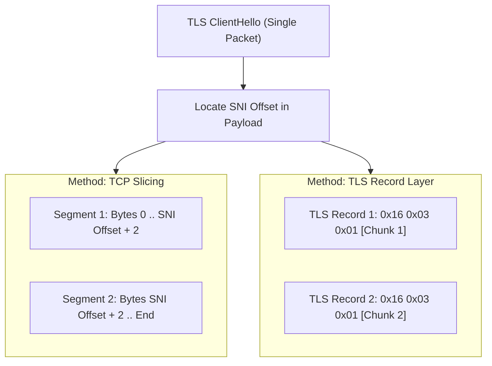

# DPI Bypass Engines & Packet Desynchronization Guide

Deep Packet Inspection (DPI) systems deployed by Internet Service Providers (ISPs) analyze Layer 4 (TCP/UDP) and Layer 7 (HTTP Host headers, TLS ClientHello Server Name Indication) to block restricted resources.

Butterfly incorporates three multi-tiered DPI circumvention mechanisms:
1. **`zapret2` Engine** (`nfqws2` on Linux, `winws2.exe` on Windows): Low-level kernel packet queue interception and state desynchronization.
2. **Driverless TLS Fragmentation Proxy** (`127.0.0.1:8085`): Pure-Dart user-space HTTP CONNECT proxy splitting the TLS ClientHello at the SNI boundary.
3. **Legacy GoodbyeDPI Engine** (`goodbyedpi.exe`): Backward-compatible fallback for legacy Windows systems.

---

## 1. `zapret2` Engine Overview

`zapret2` is the modern successor to zapret and GoodbyeDPI, designed to evade advanced middleboxes (e.g., TSPU/RKN, state firewalls) using advanced TCP/UDP packet mangling.

### 1.1 Linux Implementation (`nfqws2` + `nftables`)
- **Binary**: `nfqws2`
- **Interception**: Netfilter Queue (`NFQUEUE 510`)
- **Firewall Rules**:
  ```nft
  table inet butterfly_dpi {
    chain output {
      type filter hook output priority 0; policy accept;
      meta skuid != 0 tcp dport {80, 443} ct state new,established queue flags bypass to 510
      meta skuid != 0 udp dport 443 ct state new,established queue flags bypass to 510
    }
  }
  ```
- **Fail-Open Resilience**: The `queue flags bypass` directive guarantees that if `nfqws2` terminates unexpectedly, traffic continues flowing transparently without freezing connections.

### 1.2 Windows Implementation (`winws2.exe` + `WinDivert`)
- **Binary**: `winws2.exe`
- **Interception**: `WinDivert` kernel driver (interception filter `outbound and ip and (tcp.DstPort == 80 or tcp.DstPort == 443)`)
- **Orphan Guard**: Automatically detects and terminates orphaned `WinDivert` services prior to launching `winws2` to prevent driver initialization collisions.

---

## 2. Supported Strategy Catalog

Butterfly includes 5 curated, real-world battle-tested strategies derived from Ghostline:

| Strategy ID | Name | Engine Arguments (TCP) | Engine Arguments (QUIC) | Primary Target / Mechanism |
| :--- | :--- | :--- | :--- | :--- |
| `z-split` | **TCP Split** | `--dpi-desync=split2` | `--dpi-desync=fake` | Splits HTTP/TLS request payloads into separate TCP segments across the SNI. |
| `z-disorder` | **TCP Out-of-Order** | `--dpi-desync=disorder2` | `--dpi-desync=fake` | Transmits packet segments out of order; middleboxes fail to assemble the stream while endpoints reconstruct it. |
| `z-fake` | **Fake Packet Injection** | `--dpi-desync=fake --dpi-desync-fooling=badsum` | `--dpi-desync=fake` | Sends an initial fake packet with invalid checksum or corrupted payload that middleboxes inspect and drop. |
| `z-fake-ttl` | **Fake Packet + Low TTL** | `--dpi-desync=fake --dpi-desync-ttl=8` | `--dpi-desync=fake` | Injects fake packets with a TTL calibrated to reach the ISP middlebox but expire before reaching the remote destination. |
| `z-custom` | **Custom Profile** | User-defined parameters | User-defined parameters | Power users can enter arbitrary `nfqws2` or `winws2` CLI flags with real-time argument preview. |

---

## 3. Driverless TLS ClientHello Fragmentation Proxy

For environments where kernel drivers cannot be installed or administrator/root elevation is restricted, Butterfly provides a **driverless userspace proxy**:

- **Listen Address**: `127.0.0.1:8085` (HTTP CONNECT)
- **Zero Kernel Dependencies**: Implemented purely in Dart using `dart:io` sockets.

### 3.1 Packet Parsing & SNI Detection
When a client sends an initial TLS ClientHello over the established tunnel:
1. Validates TLS Record header:
   - Byte `0`: `0x16` (Handshake)
   - Bytes `1..2`: `0x03, 0x01` (TLS 1.0) or `0x03, 0x03` (TLS 1.2)
   - Byte `5`: `0x01` (ClientHello)
2. Traverses Extensions to locate Extension Type `0x0000` (Server Name Indication).
3. Extracts the exact byte offset range of the host name string (e.g. `example.com`).

### 3.2 Fragmentation Methods



1. **TCP Segment Slicing** (`TlsFragMethod.tcp`):
   - Slices the ClientHello byte buffer into two chunks within the SNI boundary.
   - Emits Fragment 1, invokes `upstream.flush()`, then emits Fragment 2 with `SocketOption.tcpNoDelay = true` to disable Nagle's coalescing algorithm.
2. **TLS Record Layer Slicing** (`TlsFragMethod.record`):
   - Wraps fragmented chunks into valid individual TLS records (`0x16, 0x03, 0x01, <len>`). Complies strictly with RFC 8446 record layer processing while blinding middlebox SNI scanners.
3. **Hybrid Both** (`TlsFragMethod.both`):
   - Combines both record wrapping and TCP segment flushing for maximum bypass penetration.

---

## 4. GoodbyeDPI Legacy Engine

On Windows systems lacking modern CPU feature sets or when running in compatibility environments, Butterfly provides seamless fallback to `GoodbyeDPI`:
- **Modes**:
  - `-1`: Most compatible basic bypass.
  - `-1 --fake-gen=1`: Standard bypass with fake packets.
  - `-9`: Aggressive universal bypass.
  - `--blacklist <file>`: Region-targeted domain filtering.

---

## 5. Troubleshooting & FAQ

### Q: Why does the browser report `PR_END_OF_FILE_ERROR` or connection reset?
Some ISP middleboxes employ stateful TCP resets (RST injection) if they detect corrupted checksums. Switch from `z-fake` to `z-split` or `z-fake-ttl` with adjusted TTL distance.

### Q: Does the driverless proxy bypass UDP / QUIC traffic?
No. Because HTTP CONNECT proxies operate over TCP, browsers automatically fall back from HTTP/3 (QUIC/UDP) to HTTP/2 (TLS over TCP), where fragmentation takes effect.

### Q: How do I configure my browser to use the TLS fragmentation proxy?
Configure your browser or operating system proxy settings to:
- **HTTP Proxy**: `127.0.0.1`
- **Port**: `8085`
- (Supports Chrome, Firefox, Edge, Brave, and `curl -x http://127.0.0.1:8085`).
