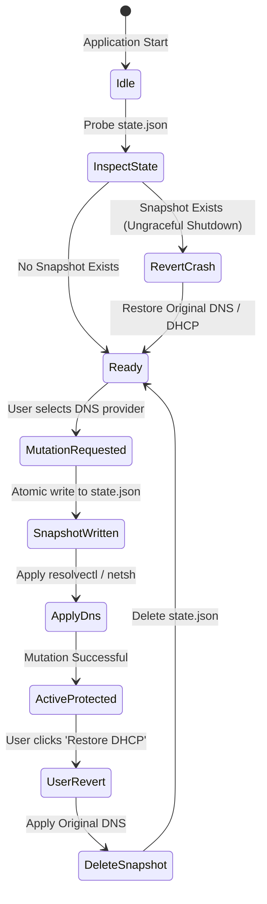

# Bulletproof DNS Safety Net Specification

One of the most frequent points of failure in desktop network management software is **orphaned DNS states**. When an application alters system DNS settings (via `resolvectl` on Linux or `netsh` on Windows) and subsequently crashes, freezes, or is force-killed by the user, the operating system can remain bound to unresponsive or misconfigured DNS resolvers, entirely severing internet connectivity.

Butterfly eliminates this risk with its **Bulletproof DNS Safety Net** (`DnsSafetyNetServiceImpl`).

---

## 1. Safety Net Lifecycle & State Machine



---

## 2. Snapshot Schema & Persistence

Before any DNS mutation is executed against the host operating system, the current state of the active network interface is captured into an immutable data structure and serialized to `state.json`:

### 2.1 File Location
- **Linux**: `${XDG_DATA_HOME:-~/.local/share}/butterfly/state.json` (or `/tmp/butterfly_safety_net/` during test sandboxing).
- **Windows**: `%LOCALAPPDATA%\Butterfly\state.json`.

### 2.2 JSON Schema
```json
{
  "interfaceName": "wlp3s0",
  "isDhcp": true,
  "dnsServers": [
    "192.168.1.1",
    "1.1.1.1"
  ],
  "timestamp": "2026-10-19T11:15:30.123Z"
}
```

### 2.3 Field Definitions
- `interfaceName` (`string`, required): Identifier of the network interface (e.g., `eth0`, `wlan0`, `Wi-Fi`, `Ethernet`).
- `isDhcp` (`boolean`, required): Indicates whether the adapter was previously configured for automatic DHCP addressing.
- `dnsServers` (`array[string]`, required): List of static DNS server IP addresses if `isDhcp` is false.
- `timestamp` (`string` ISO-8601, required): UTC timestamp when the snapshot was armed.

---

## 3. Crash Recovery Protocol

1. **Bootstrap Initialization**:
   - During `NetworkDnsViewModel.loadInitialData()`, the view model invokes:
     ```dart
     if (await safetyNetService.hasPendingRestore()) {
       final snapshot = await safetyNetService.readSnapshot();
       if (snapshot != null) {
         await safetyNetService.restoreOriginalDns(networkService);
       }
     }
     ```
2. **Reversion Execution**:
   - If `isDhcp` was `true`, executes `networkService.restoreDns(snapshot.interfaceName)`.
   - If `isDhcp` was `false`, reapplies the original `snapshot.dnsServers` via `networkService.setDns(...)`.
3. **Atomic Unlink**:
   - Upon successful reapplication, `state.json` is deleted from disk.
   - The user is notified via the HUD with:
     `"Safety Net: Restored network after previous ungraceful shutdown"`.

---

## 4. Defensive Robustness & Edge Cases

The Safety Net is built to withstand extreme corruption scenarios:

| Failure Scenario | Defensive Handling |
| :--- | :--- |
| **Corrupted or Truncated `state.json`** | Caught by `readSnapshot()` inside a `try/catch` block; logs warning and safely discards corrupted payload without throwing or crashing the UI. |
| **Missing Network Interface** | If the physical network adapter was disconnected while the machine was powered off, the restore gracefully handles missing interface errors and purges stale snapshots. |
| **Permission Denied During Restore** | Surfaces an actionable notification to the user requesting administrative escalation (`pkexec` / UAC) rather than failing silently. |
| **Rapid Successive Mutations** | Thread-safe atomic file writing ensures new snapshots overwrite prior snapshots cleanly without file race conditions. |

---

## 5. Automated Verification

The Safety Net is verified by unit tests in [`test/unit/dns_safety_net_test.dart`](file:///home/sensei/Projects/flutter/butterfly/test/unit/dns_safety_net_test.dart):
- `snapshotCurrentDns serializes adapter state to disk`
- `restoreOriginalDns reapplies original static DNS and deletes state.json`
- `restoreOriginalDns reverts to DHCP when snapshot was automatic`
- `readSnapshot handles corrupt or empty state.json gracefully without crashing`
