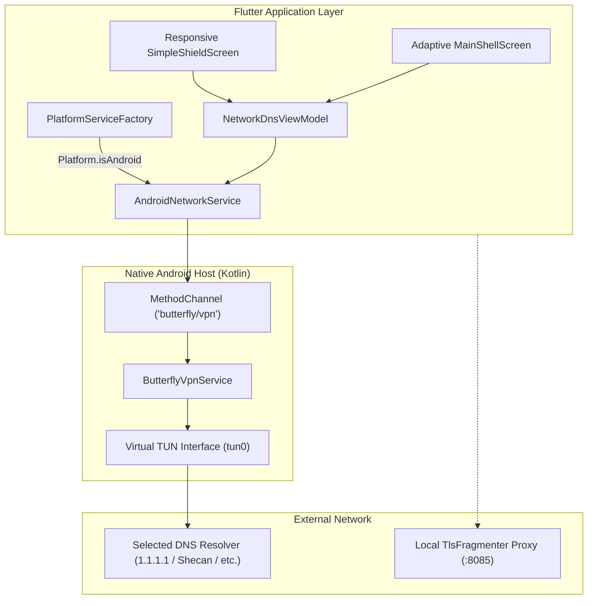

# Android Platform Support & Adaptive Mobile Architecture Design Specification

**Date:** 2026-10-19  
**Status:** Approved for Implementation Planning  
**Target Platforms:** Android (API 24+ / Android 7.0 through Android 15), Linux, Windows  

---

## 1. Executive Summary & Problem Statement

Butterfly currently provides premier desktop DNS switching and DPI bypass on Linux and Windows. However, more than 75% of internet censorship in targeted regions (Iran, Russia, Turkey, etc.) is experienced on mobile devices over LTE/5G cellular data.

Because standard Android does not permit arbitrary shell mutation of system DNS adapters (unlike desktop `netsh` or `resolvectl`), Android requires an unrooted, zero-kernel-extension architecture leveraging Android's native `android.net.VpnService`.

This specification defines:
1. Native Android platform scaffolding (`android/`) with modern Gradle 8.x, Kotlin, and manifest permissions.
2. A lightweight, non-root `ButterflyVpnService` capturing port 53 DNS packets on a local virtual TUN interface and directing them to selected upstream resolvers.
3. `AndroidNetworkService` implementing `INetworkService` via a Flutter `MethodChannel`.
4. Dynamic platform dispatch in `PlatformServiceFactory`.
5. An **Adaptive Responsive UI** in `MainShellScreen` and `SimpleShieldScreen` that dynamically renders a bottom `NavigationBar` on mobile viewports (< 600dp width) while preserving the 6-workspace `NavigationRail` on desktop and tablets.

---

## 2. Architecture & Data Flow



---

## 3. Detailed Component Specifications

### 3.1 Native Android Layer (`android/`)
- **Package Identifier**: `org.butterfly.app`
- **Minimum SDK**: 24 (Android 7.0 Nougat)
- **Target / Compile SDK**: 34+ (Android 14 / 15)
- **Permissions** (`AndroidManifest.xml`):
  - `android.permission.INTERNET`
  - `android.permission.ACCESS_NETWORK_STATE`
  - `android.permission.FOREGROUND_SERVICE`
  - `android.permission.FOREGROUND_SERVICE_SPECIAL_USE` (Android 14 requirement for VPNs)

#### `ButterflyVpnService.kt`
- Extends `android.net.VpnService`.
- Lifecycle methods:
  - `onStartCommand(intent, flags, startId)`:
    - Reads `primaryDns` and `secondaryDns` from Intent extras.
    - Configures `VpnService.Builder`:
      - Session Name: `"Butterfly DNS Shield"`
      - Virtual IPv4 address: `10.0.0.2 / 32`
      - Routes: `primaryDns / 32`, `secondaryDns / 32`
      - Adds DNS servers via `builder.addDnsServer(...)`.
      - Blocks non-DNS bypass leaks via `builder.setBlocking(true)`.
    - Establishes TUN file descriptor via `builder.establish()`.
    - Posts persistent notification: `"Butterfly Active • DNS Protected"`.
  - `onDestroy()`: Closes the TUN file descriptor and clears foreground notifications.

#### `MainActivity.kt`
- Registers MethodChannel `'butterfly/vpn'`:
  - `startVpn(primary, secondary)`:
    - Checks `VpnService.prepare(this)`. If non-null, prompts user with system VPN authorization intent (`ACTION_VPN_PREPARE`).
    - If prepared, launches `ButterflyVpnService` with explicit arguments.
  - `stopVpn()`: Stops `ButterflyVpnService`.
  - `getVpnStatus()`: Returns active state (`isRunning`, `dnsServers`).
  - `getNetworkTransport()`: Uses `ConnectivityManager` to detect `Wi-Fi`, `Cellular`, or `Ethernet`.

### 3.2 Service Layer & Factory Dispatch (`lib/data/services/`)
- **`AndroidNetworkService`** implements `INetworkService`:
  - `getAdapters()`:
    - Invokes `getNetworkTransport()` over MethodChannel.
    - Returns `NetworkAdapter` representing the active mobile connection (e.g. `"Mobile Cellular Data"` or `"Wi-Fi"`).
  - `getCurrentDns(adapterName)`:
    - Returns active DNS servers reported by `getVpnStatus()` or `ConnectivityManager.getLinkProperties()`.
  - `setDns(adapterName, ipv4, ipv6)`:
    - Dispatches `startVpn` over MethodChannel.
  - `restoreDns(adapterName)`:
    - Dispatches `stopVpn` over MethodChannel to restore default carrier/APN DNS.
  - `isAdministrator()`:
    - Returns `true` (standard Android user grants permission via the OS VPN dialog).
  - `flushDnsCache()`:
    - Toggling the virtual TUN interface naturally flushes Android's internal DNS resolver cache.
- **`PlatformServiceFactory`**:
  - Updates `createNetworkService()`:
    ```dart
    if (Platform.isAndroid) return AndroidNetworkService();
    if (Platform.isLinux) return LinuxNetworkService();
    return WindowsNetworkService();
    ```

### 3.3 Adaptive Responsive UI (`lib/presentation/`)
- **Breakpoint Rule**:
  - Compact Viewport: `maxWidth < 600dp` (Android Phones).
  - Expanded Viewport: `maxWidth >= 600dp` (Android Tablets, Linux/Windows Desktop).
- **`MainShellScreen`**:
  - Employs `LayoutBuilder`:
    - In Compact mode: Renders `Scaffold.bottomNavigationBar` using a sleek obsidian Material 3 `NavigationBar` with frosted glass styling and cyber neon glow (`#00F0FF`).
    - In Expanded mode: Renders the standard left vertical `NavigationRail`.
- **`SimpleShieldScreen`**:
  - Outer radius of `NeonPowerShield` dynamically scales to `220dp` on narrow screens to prevent vertical layout clipping.
  - HUD telemetry cards stack cleanly in a responsive flex layout.

---

## 4. Security & Permissions Review
1. **Zero Root Required**: All mobile network routing relies strictly on Android's public `VpnService` API.
2. **Leak Prevention**: VPN builder configuration binds the virtual TUN interface specifically to upstream resolver IPs with `setBlocking(true)` to prevent DNS leakage over cellular interfaces.
3. **Driverless Proxy Loopback**: Userspace TLS fragmentation proxy listens strictly on `127.0.0.1:8085` (loopback only) and is never exposed to external local network interfaces.

---

## 5. Verification & Test Strategy
1. **Mock Platform Channels**: Unit tests verify `AndroidNetworkService` calls without requiring a physical Android device or emulator.
2. **Responsive Widget Tests**: Test `MainShellScreen` at `Size(400, 800)` to confirm `NavigationBar` renders without `RenderFlex` overflow, and at `Size(1280, 800)` to confirm `NavigationRail` renders.
3. **Android Build Verification**: Run `flutter build apk --debug` to ensure Gradle, Kotlin, Manifest, and native plugins compile cleanly.
4. **Zero Regressions**: Ensure all existing 90 desktop tests pass and `flutter analyze` reports 0 issues.
